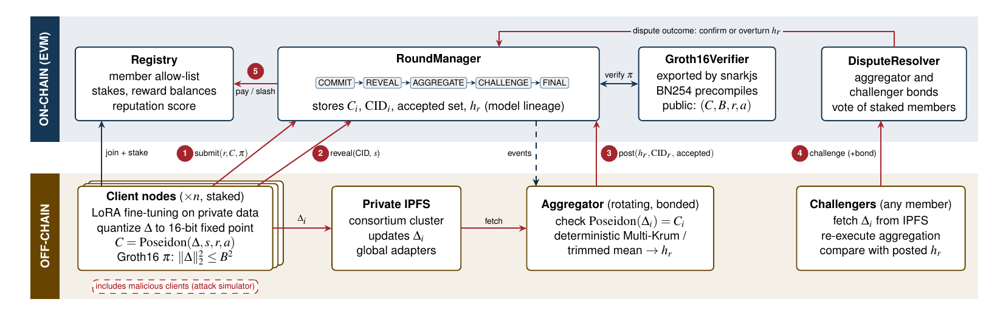

# ZK-FedChain

**Blockchain-governed federated fine-tuning of language models with zero-knowledge verified updates**

CSE 540 &middot; Group 30 &middot; Md Fahim Ul Islam, Faisal Al-Qahtani, Sri Vignesh Madasu, Meshari Alqahtani

> Status: **project update milestone, about 65% of the planned
> implementation**. All smart contracts are implemented and tested, including
> the full training round, rewards, penalties and disputes. The ZK circuit and
> its trusted setup are in place, and a terminal demo shows the stakeholder
> interactions. Real LoRA training, evaluation and the testnet deployment are
> next (see [Project status](#7-project-status)).

---

## 1. Project description

In federated learning (FL), several organizations fine-tune one shared model
while keeping their training data private. The usual protocol still needs a
central server that every participant trusts: the server decides which client
updates are merged, publishes the new model, and keeps the only record of who
contributed. Malicious clients can also poison the model with backdoored or
scaled updates.

ZK-FedChain replaces the trusted server with Ethereum smart contracts:

- Each client proves with a **Groth16 zero-knowledge proof** that its update
  stays within an agreed norm bound, without revealing the update. The
  `RoundManager` contract verifies the proof on-chain before accepting it.
- The contracts hold the **round state**, a tamper-evident **history of global
  model hashes**, member **stake**, **reputation** and **ERC-20 rewards**.
- Robust aggregation (Multi-Krum / trimmed mean) runs **off-chain**, is
  accepted optimistically, and can be **challenged** by any staked member.
- Model weights never go on-chain; the contracts only store Poseidon
  commitments, IPFS content identifiers (CIDs) and model hashes.

The first prototype targets DistilBERT with LoRA adapters on SST-2, with
10 to 20 simulated clients.



## 2. Smart-contract components

| Contract | Interface | Responsibility | Key functions | Status |
|----------|-----------|----------------|---------------|--------|
| `Registry` | `IRegistry` | Member allow-list, ETH stake, reputation, slashing | `addMember`, `depositStake`, `withdrawStake`, `slash`, `adjustReputation`, `lockStake`, `isEligible` | Implemented |
| `RoundManager` | `IRoundManager` | Round state machine, proof check, model lineage, rewards | `startRound`, `submitUpdate`, `revealUpdate`, `postAggregate`, `advancePhase`, `finalizeRound`, `latestModel` | Implemented |
| `Groth16Verifier` | `IGroth16Verifier` | Verifies the norm-bound proof (generated by snarkjs) | `verifyProof` | Generated by `npm run circuit:build` |
| `DisputeResolver` | `IDisputeResolver` | Challenges against an aggregate, voting, bonds | `openChallenge`, `castVote`, `resolve` | Implemented |
| `FedRewardToken` | `IFedRewardToken` | ERC-20 reward token (FCR), minted only by `RoundManager` | `mint` | Implemented |
| `MockVerifier` | `IGroth16Verifier` | Test stand-in for the verifier before the circuit is ready | `verifyProof`, `setResult` | Implemented |

Shared structs and enums (`Phase`, `Proof`, `RoundConfig`, `Round`,
`Submission`, `Dispute`) are in `contracts/libraries/FedTypes.sol`. Every
interface and contract carries NatSpec comments describing its purpose,
parameters and how it interacts with the other contracts.

**Round lifecycle.** `Commit -> Reveal -> Aggregate -> Challenge -> Finalized`
(or `Disputed -> Finalized`). Clients submit a commitment and proof, reveal
the IPFS CID of their update, the selected aggregator posts the new model
hash with a bond, and after the challenge window the round is finalized and
rewards are paid. The full protocol, sequence diagram and penalty table are in
[`docs/protocol.md`](docs/protocol.md).

## 3. Repository structure

```
zk-fed/
├── contracts/
│   ├── interfaces/          # IRegistry, IRoundManager, IDisputeResolver, IGroth16Verifier, IFedRewardToken
│   ├── libraries/FedTypes.sol
│   ├── Registry.sol
│   ├── RoundManager.sol
│   ├── DisputeResolver.sol
│   ├── FedRewardToken.sol
│   ├── mocks/MockVerifier.sol
│   └── verifier/            # Groth16Verifier.sol is generated here by the circuit build
├── circuits/
│   ├── norm_bound.circom    # range check + norm bound + Poseidon commitment
│   └── build_circuit.sh     # compile, trusted setup, export Solidity verifier
├── offchain/
│   ├── zkfed/               # Python client, aggregator (Multi-Krum), challenger, prover, chain + IPFS helpers
│   ├── tests/               # unit tests for encoding and aggregation
│   └── requirements.txt
├── scripts/
│   ├── deploy.js            # deploys and wires all contracts
│   └── demo.js              # terminal demo of a full round and a dispute
├── test/RoundLifecycle.test.js
├── docs/                    # architecture figure and protocol notes
├── hardhat.config.js
├── package.json
└── .env.example
```

## 4. Dependencies

All tools are free and open source.

| Area | Tool | Version used |
|------|------|--------------|
| Runtime | Node.js, npm | Node 18 or newer (tested with 22) |
| Smart contracts | Solidity, Hardhat, Hardhat Toolbox (ethers v6, chai, gas reporter) | solc 0.8.24, Hardhat 2.x |
| Contract libraries | OpenZeppelin Contracts (`AccessControl`, `ReentrancyGuard`, `ERC20`) | 5.x |
| Zero-knowledge | circom, circomlib, snarkjs | circom 2.1.x, circomlib 2.0.5, snarkjs 0.7.x |
| Off-chain nodes | Python, numpy, web3.py, requests | Python 3.10 or newer |
| Model training | PyTorch, Hugging Face Transformers, PEFT, Datasets | see `offchain/requirements.txt` |
| Storage | IPFS (Kubo) | any recent release |
| Networks | Hardhat local network, Ethereum Sepolia testnet, Hyperledger Besu (optional) | |

## 5. Setup

```bash
git clone https://github.com/Fahim-ok/zk-fed.git
cd zk-fed

# JavaScript tool-chain (Hardhat, OpenZeppelin, snarkjs, circomlib)
npm install

# Compile the contracts and run the tests (uses MockVerifier)
npx hardhat compile
npx hardhat test

# Python environment for the off-chain nodes
python -m venv .venv
source .venv/bin/activate          # Windows: .venv\Scripts\activate
pip install -r offchain/requirements.txt
python -m pytest offchain/tests
```

To build the ZK circuit you also need the circom compiler. Install it with
Rust (`cargo install --git https://github.com/iden3/circom.git`) or use the
WebAssembly build (`npm install -g circom2`).

## 6. Usage and deployment

### 6.1 Run the demo

```bash
npm run demo                     # same as: npx hardhat run scripts/demo.js
SKIP_DISPUTE=1 npm run demo      # shorter version: round 1 only
```

The demo runs on Hardhat's built-in chain, so nothing else needs to be
started. It prints every stakeholder action in order: the admin deploys the
contracts, five organizations join and stake, a round starts and an
aggregator is selected, honest clients submit proofs, a client with an
invalid proof is slashed, clients reveal, the aggregator posts the new
model, and rewards are paid. A second round shows a dishonest aggregator
being challenged, voted on and slashed. Proofs are checked by
`MockVerifier` in the demo so it runs in seconds.

### 6.2 Local chain

```bash
npx hardhat node                                       # terminal 1: local chain on :8545
npx hardhat run scripts/deploy.js --network localhost   # terminal 2
```

`deploy.js` deploys `MockVerifier` (local only), `FedRewardToken`, `Registry`,
`RoundManager` and `DisputeResolver`, grants the roles between them, and
writes the addresses to `deployments/localhost.json`, which the Python nodes
read.

### 6.3 Build the circuit and the real verifier

```bash
npm run circuit:build                 # or: CIRCOM="npx circom2" npm run circuit:build
npx hardhat compile                   # now includes contracts/verifier/Groth16Verifier.sol
USE_REAL_VERIFIER=true npx hardhat run scripts/deploy.js --network localhost
```

The circuit uses `D = 1024` coordinates (about 57k constraints, so a 2^16
Powers of Tau file is enough). The script runs a development-only trusted
setup, which takes roughly 20 to 25 minutes on a laptop; placing a public
Powers of Tau file at `circuits/build/pot_final.ptau` skips most of that time.

### 6.4 Sepolia testnet (planned)

```bash
cp .env.example .env        # fill in SEPOLIA_RPC_URL and a test-only PRIVATE_KEY
npm run circuit:build && npx hardhat compile
npx hardhat run scripts/deploy.js --network sepolia
```

## 7. Project status

Overall progress: **about 65%** of the planned implementation.

| Component | Status |
|-----------|--------|
| System design, contract interfaces and shared types | Done |
| `Registry` (membership, stake, slashing, reputation) and `FedRewardToken` | Done |
| `RoundManager`: full round (commit, reveal, aggregate, challenge, finalize) with rewards and penalties | Done, 7 Hardhat tests pass |
| `DisputeResolver`: challenges, voting and bond settlement | Done |
| Norm-bound circuit, trusted-setup script and Solidity verifier export | Done |
| Real Groth16 proof from Python accepted by `RoundManager` (about 400k gas); replayed proof rejected and slashed | Checked |
| Terminal demo of stakeholder interactions (`npm run demo`) | Done |
| Python prover, chain/IPFS wrappers, Multi-Krum and trimmed mean | Done |
| LoRA fine-tuning in the client (DistilBERT on SST-2) | In progress |
| Poseidon commitment re-check in the aggregator | In progress |
| Attack experiments and evaluation (accuracy, attack success rate, gas) | Planned |
| Sepolia deployment and final demo | Planned |

Known limitations, marked `TODO` in the code: aggregator selection uses
`block.prevrandao` (a VRF would be stronger), stake locks are not yet
extended during an open dispute, and clients of an overturned round are not
re-aggregated.

## 8. Team

| Member | Responsibility |
|--------|----------------|
| Md Fahim Ul Islam (lead) | Smart contracts and interfaces, Hardhat tests and deployment script, Circom circuit and trusted-setup script, verifier integration, Python off-chain nodes (client, aggregator, challenger, IPFS and web3.py), documentation, literature review, meetings |

## 9. License

MIT. See [LICENSE](LICENSE).
