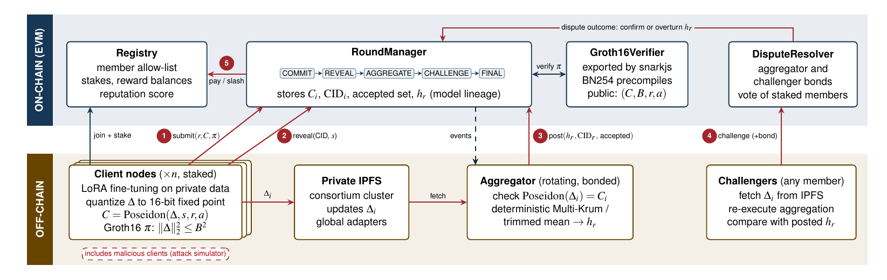

# ZK-FedChain

**Blockchain-governed federated fine-tuning of language models with zero-knowledge verified updates**

CSE 540 &middot; Group 30 &middot; Md Fahim Ul Islam, Faisal Al-Qahtani, Sri Vignesh Madasu, Meshari Alqahtani

> Status: **smart-contract design milestone, about 40% of the planned
> implementation**. All contract interfaces are defined; membership, staking
> and the Commit/Reveal phases are implemented and tested with a mock
> verifier. Aggregation, disputes, the trusted setup and the off-chain nodes
> are the next steps (see [Project status](#7-project-status)).

---

## 1. Project description

In federated learning (FL), several organizations fine-tune one shared model
while keeping their training data private. The usual protocol still needs a
central server that every participant trusts: the server decides which client
updates are merged, publishes the new model, and keeps the only record of who
contributed. Malicious clients can also poison the model with backdoored or
scaled updates.

ZK-FedChain replaces the trusted server with Ethereum smart contracts:

- Each client proves with a **Groth16 zero-knowledge proof** that its update
  stays within an agreed norm bound, without revealing the update. The
  `RoundManager` contract verifies the proof on-chain before accepting it.
- The contracts hold the **round state**, a tamper-evident **history of global
  model hashes**, member **stake**, **reputation** and **ERC-20 rewards**.
- Robust aggregation (Multi-Krum / trimmed mean) runs **off-chain**, is
  accepted optimistically, and can be **challenged** by any staked member.
- Model weights never go on-chain; the contracts only store Poseidon
  commitments, IPFS content identifiers (CIDs) and model hashes.

The first prototype targets DistilBERT with LoRA adapters on SST-2, with
10 to 20 simulated clients.



## 2. Smart-contract components

| Contract | Interface | Responsibility | Key functions | Status |
|----------|-----------|----------------|---------------|--------|
| `Registry` | `IRegistry` | Member allow-list, ETH stake, reputation, slashing | `addMember`, `depositStake`, `withdrawStake`, `slash`, `adjustReputation`, `lockStake`, `isEligible` | Implemented |
| `RoundManager` | `IRoundManager` | Round state machine, proof check, model lineage, rewards | `startRound`, `submitUpdate`, `revealUpdate`, `postAggregate`, `advancePhase`, `finalizeRound`, `latestModel` | Commit/Reveal implemented; aggregation and finalization stubbed |
| `Groth16Verifier` | `IGroth16Verifier` | Verifies the norm-bound proof (generated by snarkjs) | `verifyProof` | Interface only |
| `DisputeResolver` | `IDisputeResolver` | Challenges against an aggregate, voting, bonds | `openChallenge`, `castVote`, `resolve` | Signatures only |
| `FedRewardToken` | `IFedRewardToken` | ERC-20 reward token (FCR), minted only by `RoundManager` | `mint` | Implemented |
| `MockVerifier` | `IGroth16Verifier` | Test stand-in for the verifier before the circuit is ready | `verifyProof`, `setResult` | Implemented |

Shared structs and enums (`Phase`, `Proof`, `RoundConfig`, `Round`,
`Submission`, `Dispute`) are in `contracts/libraries/FedTypes.sol`. Every
interface and contract carries NatSpec comments describing its purpose,
parameters and how it interacts with the other contracts. Functions planned
for later milestones keep their final signatures and revert with
`NotImplemented()`.

**Round lifecycle.** `Commit -> Reveal -> Aggregate -> Challenge -> Finalized`
(or `Disputed -> Finalized`). Clients submit a commitment and proof, reveal
the IPFS CID of their update, the selected aggregator posts the new model
hash with a bond, and after the challenge window the round is finalized and
rewards are paid. The full protocol, sequence diagram and penalty table are in
[`docs/protocol.md`](docs/protocol.md).

## 3. Repository structure

```
zk-fed/
├── contracts/
│   ├── interfaces/          # IRegistry, IRoundManager, IDisputeResolver, IGroth16Verifier, IFedRewardToken
│   ├── libraries/FedTypes.sol
│   ├── Registry.sol
│   ├── RoundManager.sol
│   ├── DisputeResolver.sol
│   ├── FedRewardToken.sol
│   ├── mocks/MockVerifier.sol
│   └── verifier/            # Groth16Verifier.sol will be generated here (next milestone)
├── circuits/
│   └── norm_bound.circom    # draft: range check + norm bound + Poseidon commitment
├── offchain/
│   ├── zkfed/               # Python node interfaces (client, aggregator, challenger, chain, IPFS)
│   ├── tests/               # unit tests for the fixed-point encoding
│   └── requirements.txt
├── scripts/deploy.js        # deploys and wires all contracts
├── test/RoundLifecycle.test.js
├── docs/                    # architecture figure and protocol notes
├── hardhat.config.js
├── package.json
└── .env.example
```

## 4. Dependencies

All tools are free and open source.

| Area | Tool | Version used |
|------|------|--------------|
| Runtime | Node.js, npm | Node 18 or newer (tested with 22) |
| Smart contracts | Solidity, Hardhat, Hardhat Toolbox (ethers v6, chai, gas reporter) | solc 0.8.24, Hardhat 2.x |
| Contract libraries | OpenZeppelin Contracts (`AccessControl`, `ReentrancyGuard`, `ERC20`) | 5.x |
| Zero-knowledge | circom, circomlib, snarkjs | circom 2.1.x, circomlib 2.0.5, snarkjs 0.7.x |
| Off-chain nodes | Python, numpy, web3.py, requests | Python 3.10 or newer |
| Model training | PyTorch, Hugging Face Transformers, PEFT, Datasets | see `offchain/requirements.txt` |
| Storage | IPFS (Kubo) | any recent release |
| Networks | Hardhat local network, Ethereum Sepolia testnet, Hyperledger Besu (optional) | |

## 5. Setup

```bash
git clone https://github.com/Fahim-ok/zk-fed.git
cd zk-fed

# JavaScript tool-chain (Hardhat, OpenZeppelin, snarkjs, circomlib)
npm install

# Compile the contracts and run the tests (uses MockVerifier)
npx hardhat compile
npx hardhat test

# Python environment for the off-chain nodes
python -m venv .venv
source .venv/bin/activate          # Windows: .venv\Scripts\activate
pip install -r offchain/requirements.txt
python -m pytest offchain/tests
```

The ZK part will also need the circom compiler. Install it with Rust
(`cargo install --git https://github.com/iden3/circom.git`) or use the
WebAssembly build (`npm install -g circom2`).

## 6. Usage and deployment

### 6.1 Local chain

```bash
npx hardhat node                                  # terminal 1: local chain on :8545
npx hardhat run scripts/deploy.js --network localhost   # terminal 2
```

`deploy.js` deploys `MockVerifier` (local only), `FedRewardToken`, `Registry`,
`RoundManager` and `DisputeResolver`, grants the roles between them, and
writes the addresses to `deployments/localhost.json`, which the Python nodes
read.

### 6.2 Next steps for deployment (planned)

1. Compile `circuits/norm_bound.circom` with circom, run the Groth16 trusted
   setup with snarkjs, and export `contracts/verifier/Groth16Verifier.sol`.
2. Deploy with the real verifier on the local chain
   (`USE_REAL_VERIFIER=true npx hardhat run scripts/deploy.js --network localhost`).
3. Deploy to Sepolia after filling in `.env` from `.env.example`
   (`npx hardhat run scripts/deploy.js --network sepolia`).
4. Connect the Python client, aggregator and challenger nodes in
   `offchain/zkfed/` to the deployed contracts and run full rounds.

## 7. Project status

Overall progress: **about 40%** of the planned implementation.

| Component | Status |
|-----------|--------|
| System design, contract interfaces and shared types | Done |
| `Registry` (membership, stake, slashing, reputation) and `FedRewardToken` | Done |
| `RoundManager`: round start, aggregator selection, Commit (proof check) and Reveal | Done, tested with `MockVerifier` |
| `RoundManager`: aggregation, challenge window, finalization and rewards | Next milestone |
| `DisputeResolver`: challenges, voting and bond settlement | Next milestone |
| Norm-bound circuit | Draft written; trusted setup and verifier export next |
| Off-chain nodes (LoRA client, Multi-Krum aggregator, challenger, IPFS) | Interfaces defined; implementation next |
| Attack simulation, evaluation and Sepolia deployment | Planned |

## 8. Team

| Member | Responsibility |
|--------|----------------|
| Md Fahim Ul Islam (lead) | Smart contracts and interfaces, Hardhat tests and deployment script, Circom circuit and trusted-setup script, verifier integration, Python off-chain nodes (client, aggregator, challenger, IPFS and web3.py), documentation, literature review, meetings |

## 9. License

MIT. See [LICENSE](LICENSE).
